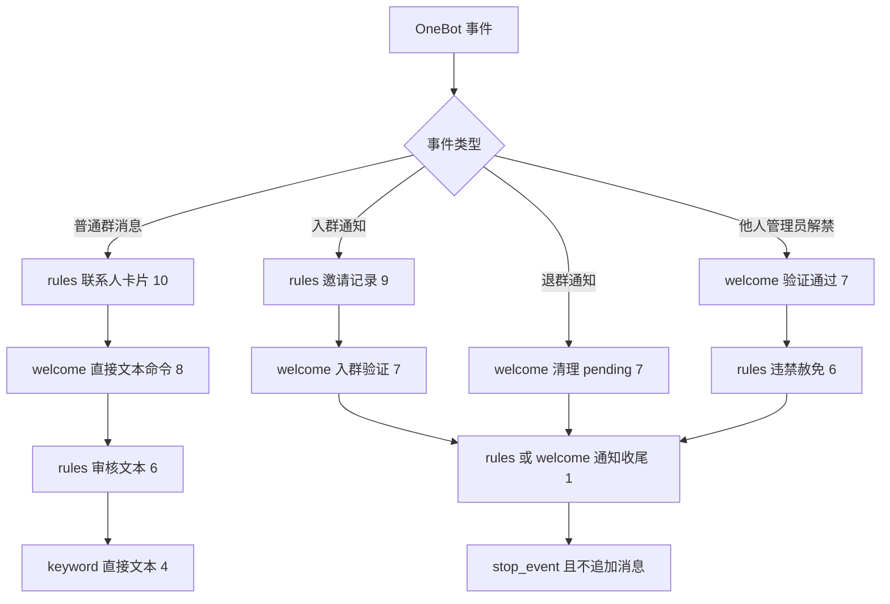

# 三插件拆分与设计缺口修订

Feature Name: split-into-three-plugins
Updated: 2026-10-11

## Description

本设计对应 [requirements.md](requirements.md)，实施顺序见 [tasklist.md](tasklist.md)。三个独立仓库为：

- rules：`astrbot_plugin_group_manager`，由原 `astrbot_plugin_w1ndys_rules` 仓库更名，承载违禁监控、黑白名单、邀请记录和调试；rules 仅为本文历史简称。
- welcome：`astrbot_plugin_group_welcome`，新建独立仓库，承载验证与欢迎。
- keyword：`astrbot_plugin_keyword_reply`，新建独立仓库，承载关键词回复。

沿用 Python + SQLite、入口 → 业务 → 数据分层和现有 React/Vite 工程，不引入公共包、插件通信框架或新数据库。新插件无额外视觉依赖，仍依赖 AstrBot 宿主。

本轮闭合四类缺口：通知提前停止、迁移与旧键清理顺序、群名草稿与原子保存、直接文本与审核文本边界。明确批准的行为调整写在需求 Introduction，不再声称所有行为完全不变。

## Architecture



普通消息分支任一业务命中时按原规则停止后续处理；通知分支的业务不提前停止，只有最后收尾终止。各处理器先区分消息与通知，不能靠正文是否为空猜通知类型。

三个仓库均在 `/Users/w1ndys/develop/github/w1ndys/` 下，保留 `entity/`、`data/`、`business/`、`main.py`、`tests/`、`dashboard/`、`pages/console/` 的结构。文档阶段不创建远端或目录外源码。

### 插件更名与原库接续

最终仓库目录为 `astrbot_plugin_group_manager/`、`astrbot_plugin_group_welcome/`、`astrbot_plugin_keyword_reply/`。实施时先核对目标名称是否被占用；原仓库更名保留历史，更新 origin 与 metadata.repo，不能宣称这些新远端已经存在。当前 spec 仍留在原工作区，不在设计阶段移动工作区。

三个插件的 metadata.name、PLUGIN_NAME、包导入、测试导入、API 前缀、Pages bridge 和构建命名同步改为正式名称。作者、GitHub owner 和本机路径中的 w1ndys 不改；业务日志前缀保留热修后的 `[群管]`，不得恢复旧前缀或旧日志级别。原插件名只用于迁移来源和升级说明，不注册旧名插件副本。

群管新版数据库名固定为 `group_manager.db`，`DB_FILE_NAME` 同步更新。旧 `rules.db` 仅作为迁移来源；拆分、verify、备份cleanup先针对旧库执行，再通过显式 `finalize-manager` 生成宿主新数据目录中的 `group_manager.db`。即使数据目录不变也要迁移文件名，不继续默认打开rules.db。保留旧库及清理前备份，不自动删除，不因目标缺失而把新建空库当作升级成功。

新旧插件只启用一个；更新加载目录与宿主插件标识后验证新 Pages 路由及原配置/日志可读。GitHub 地址重定向不保证宿主安装目录、配置路径或数据库自动迁移。此接续列入最终改名任务的自动化临时库检查，本轮不执行真实升级。

## Components and Interfaces

### 模块搬迁映射

| 模块 | 归属与处理 |
|---|---|
| `entity/constants.py` | 三个各一份，按 13/4/1 配置分片 |
| `entity/forbidden.py`、`forbidden_log.py`、`invite.py` | rules |
| `entity/keyword.py` | keyword |
| `entity/group_name.py` | 三个各一份，GroupNameStore 的必要依赖 |
| `data/db.py`、`setting_store.py`、`group_name_store.py` | 三个各一份；增加单事务设置保存能力 |
| `data/keyword_store.py` | keyword |
| `data/verify_store.py`、`welcome_store.py` | welcome |
| `data/forbidden_*_store.py`、`blacklist_store.py`、`whitelist_store.py`、`invite_store.py` | rules |
| `business/keyword_*.py`、`wake_prefix.py` | keyword；wake_prefix 读取副本也供 welcome 的直接文本规范化使用 |
| `business/verify_*.py`、`welcome_*.py`、`admin_command.py` | welcome；去除通知业务的提前 stop，纯业务逻辑不改 |
| `business/forbidden_*.py`、`group_card.py`、`whitelist.py`、`blacklist_admin.py`、`invite_*.py`、`debug_payload.py` | rules；转发展开只留 rules |
| `business/hit_log.py` | rules；保留统一命中日志及PR #25嵌套字符串打码，依赖本包debug_payload.to_plain |
| `tests/test_card_identity.py`、`tests/test_hit_log.py` | rules；整体保留热修覆盖，改名只调整包导入 |
| `business/qq_role.py` | rules、welcome 各一份 |
| `business/auth.py`、`feature_enable.py` | 三个各一份 |
| `business/settings_page.py`、`group_name_page.py` | 三个各一份；修改为草稿校验与一次性事务保存 |
| 新 `business/direct_text.py` | keyword、welcome 各一份，只解析最外层直接文本 |
| 新 `business/member_notice.py` | rules、welcome 各一份，从现有入群/退群/解禁判定抽取纯判定；无跨插件调用 |
| `main.py` | 三个各自薄入口，含本插件路由与处理器 |
| `dashboard/`、`pages/console/` | 三套独立工程/产物，按功能裁剪 |

rules 不得为了判断入群继续依赖 welcome 的 `welcome_send.py`；也不得为了判断解禁跨插件导入 `verify_unmute.py`。判定函数副本放各自 `member_notice.py`，保留原通知条件。现有 welcome 判定函数可转调本包该模块以保留测试入口，不建设通用事件框架。

### 已合并热修基线（PR #24 / #25）

拆分基于 `152076911cb845385218181daf0029053c8467eb`（PR #25合并提交），包括PR #24的联系人卡片和日志改造。不得从旧拆分分支直接覆盖这些改动；续做前对齐该基线，再调整拆分逻辑。

- `group_card.py` 整体留群管，包括 `find_contact_card`、`card_identity`、薄包装 `is_group_card`。新增app=com.tencent.contact.lua且view=contact的判据，原prompt群名片前缀、bizsrc=qun.share、meta.contact.tag群名片规则保留，不把所有JSON判成卡片。
- `card_identity` 沿用群头像gh/路径取群号、群名及推荐好友账号去前缀逻辑；身份通过log_text写日志text列并进入飞书消息。`CARD_IDENTITY_MAX_LEN=100`、`GROUP_CARD_HIT="联系人卡片"`均归群管，配置键和原因码不改。
- 文本模型、二维码、图片转写、视频抽帧、联系人卡片沿用统一处置链的 `log_hit`，一次命中事件输出一行INFO，不在拆出的多个handler重复加命中日志。管理员/白名单/未开启/越权等跳过日志保持DEBUG，启动INFO不属于逐消息跳过日志。
- 打印前走 `payload_text → to_plain → mask_payload`；字典/列表递归、敏感字段及URL参数打码保留。PR #25增加 `mask_text`、`_try_json`、`_mask_json_pairs`，覆盖JSON以字符串嵌套、CQ字符串及字符串内地址签名；沿用现有测试，不记录未脱敏载荷作为兜底。
- 字段名敏感片段匹配保持现有token/sig/sign/secret/password/passwd/key/auth口径。宽泛key匹配可能多遮；不在拆分中顺手改匹配策略、精简payload字段或翻译状态码。修复不代表历史已输出日志自动脱敏，生产日志处置另行授权。

### 直接文本边界

对应需求 2.3–2.7、3.3、3.10、11.1–11.6。

- `direct_text.py` 从 OneBot `message_obj.raw_message.message` **最外层数组**取 `type="text"` 的 `data.text`，不递归 `reply`、`forward`、`node`、`json`、`xml`、图片或视频字段。
- 同一连续 text 段按原顺序拼接后去首尾空白；各段组拼接保持当前 aiocqhttp 文本处理习惯，保留正文内部换行。最后整体 strip。
- 宿主当前会从 `event.message_str` 去除唤醒前缀，但原始段仍在。因此直接文本规范化沿用宿主配置的前缀顺序，最多去掉一个匹配的开头前缀，再 strip；不反复去前缀，不从 outline/Reply.message_str 补字。沿用 `wake_prefix` 读取约定，关键词写入时的前缀禁用规则不变。
- 原始数组缺失、通知、无 text 段均返回空串。目标平台本来要求 OneBot 消息数组；测试替身补齐真实段结构，不能为旧测试增加不安全的摘要回退。
- 混合消息只识别明确 text：引用“群规”但没有新文字不回复；引用旁新写“群规”可以匹配；仅转发内部含“群规”不匹配；图片里写“欢迎语 设置”不执行；外层直接写了命令则按正常权限处理。
- welcome 私聊交码也使用这一入口；不读取转发里的验证码。非 pending 私聊仍静默放行。
- welcome 命令沿用原 `parse_admin_command`：去 BOM、strip，查询要求完整文本等于“欢迎语”；设置要求首行等于“欢迎语 设置”或紧跟空格/Tab，支持原有多行正文。“欢迎语 设置好了”不是设置命令。
- keyword 不携带欢迎语命令排除表。共同安装时 priority 8 的 welcome 若处理命令会 stop；只有 keyword 时，直接文本按用户配置的普通关键词处理。这修正旧需求里过宽的首行/前缀排除描述。

rules 保留 `forbidden_forward.py` 及其 `call_result` 依赖。为保留现有联系人卡片拦截之前的审核展开顺序，priority 10 普通消息入口先运行一次 `resolve_audit_text`，把结果放在事件extra私有键 `group_manager.audit_text`；priority 6只读该结果，不再次查询转发。该键仅群管自己使用，其他插件不消费；事件结束即丢弃，不全局保存正文。

rules 的斜杠跳过判断继续依据审核文本；welcome/keyword 依据各自规范化直接文本。审核判断、OCR、视频、卡片业务本身不改。

### 消息、通知与收尾优先级

| 处理器 | 插件 | priority | 终止条件 |
|---|---|---:|---|
| 审核文本准备 + 联系人卡片拦截 | rules | 10 | 卡片命中普通消息 |
| 入群邀请记录 | rules | 9 | 不调用 stop |
| 欢迎语命令 | welcome | 8 | 识别为管理命令，包括原有无权静默处理 |
| 入群验证、退群清理、管理员解禁通过 | welcome | 7 | 不调用 stop |
| 违禁文本/媒体判定 | rules | 6 | 普通消息被处置 |
| 违禁解禁赦免 | rules | 6 | 不调用 stop |
| 私聊交码 | welcome | 6 | 按现有 handled 结果停止私聊事件 |
| 关键词回复 | keyword | 4 | 直接文本命中 |
| 成员通知收尾 | rules、welcome 各一份 | 1 | 仅已识别入群、退群、他人管理员解禁通知 |

`member_notice.py` 根据 `notice_type`/`sub_type`/`operator_id` 分类。管理员解禁沿用原条件：`group_ban` + `lift_ban`，操作者非空、非 0、非机器人自身。系统到期、新禁言、机器人自己解禁不算管理员通过。

收尾函数只调用 `stop_event()`，不 yield 文本、不查询兄弟插件、不依赖共享状态。两插件同装时两份收尾均为 1，无论哪份先运行都在本集合 priority 4–10 之后，第一份 stop 后第二份不运行；单装任一插件也能收尾。两插件都缺席时 keyword 不承担群管通知收尾。

业务阶段原有通知 `stop_event()` 必须删除，不能先 stop 再 continue。普通消息处理器遇到通知先返回；通知业务异常必须按现有错误处理如实记录，不能伪报已完成。宿主若因未捕获异常或其他无关插件提前 stop 而中断派发，属于宿主既有行为，本设计不保证绕过其他插件的停止决定。

验证顺序：入群 `record_join → start_pending/禁言/发码 → 收尾`；解禁 `撤验证提示/欢迎语/通过回复 → pardon_forbidden_mute → 收尾`；退群 `清 pending/撤提示 → 收尾`。

### 配置分片

| 插件 | 列表键 | 文本、整数、布尔键 | 数量 |
|---|---|---|---:|
| rules | forbidden_groups、invite_groups、forbidden_block_group_card_groups | forbidden_guideline、forbidden_samples、forbidden_remind_text、forbidden_feishu_webhook、forbidden_mute_seconds、forbidden_trigger_url/group/qq/phone/wechat | 13 |
| welcome | welcome_groups、verify_groups | welcome_text、verify_mute_seconds | 4 |
| keyword | keyword_groups | 无 | 1 |

保留原键名、值类型、默认值和 invisible；群号名单仍是字符串数组，不改成 `{group_id,group_name}` 对象数组。`load_dict()` 只返回所属键。旧 rules 库在显式 cleanup 之前可以保留 18 行，启动与保存均不自动清理；新建 rules 库只有 13 键。未知历史键只忽略，不自动删除。

### 设置与群名接口

以下是本次明确设计的插件内部 Pages API，不是新增 OneBot 协议字段。每个接口都放本插件 `PLUGIN_NAME` 命名空间下，沿用宿主 Pages 鉴权与响应包装。

| 后缀 | 请求/响应业务形状 | 作用 |
|---|---|---|
| `settings/get` | 请求 `{}`；返回本插件既有扁平配置对象 | 读取已保存配置 |
| `group-name/list` | 请求 `{}`；返回 `{items:[{group_id,group_name}]}` | 读取本插件历史名称供日志和业务页展示 |
| `group-name/pull` | 请求 `{group_ids:["群号"]}`；返回 `{items:[{group_id,group_name}]}` | 验证群号数组后调一次 get_group_list，只返回请求范围的非空名称，不写库 |
| `settings/save` | 请求 `{settings:完整本插件配置, group_names:[{group_id,group_name}]}`；成功返回 `{message}` | 原子保存配置和群名 |

独立 `group-name/save` 路由删除，避免绕过统一保存。前端与后端同步更新；旧资产调用旧路由可失败提示刷新，不兼容两套写入协议。业务关键词/欢迎语的增删改查接口保持原后缀。

前端以当前表单勾选形成名单并集（新增但未保存的群也包括），去重后发 `group-name/pull`。拉取返回时按**当前**草稿重新过滤，防止慢响应把已移除的群带回来；空名/缺群不覆盖旧草稿名称。取消、关闭页面或失败均不落库。

保存步骤：

1. 表单校验后提交完整的 13/4/1 配置及当前群名草稿，保存中禁用重复提交，失败保留草稿。
2. 业务层 `settings_page.save_settings` 校验完整键集合、类型、群号及名称；未知配置键或格式错误整份拒绝；重复同群号的冲突名称拒绝。群名范围只取本请求配置的名单并集，名单外项丢弃，空名称不用于覆盖。
3. `SettingStore.save_with_group_names` 接收已规范化值，在本插件一把写锁和一个 SQLite 连接内 BEGIN，写配置，再 upsert 非空有效群名，最后 COMMIT；任一步失败 ROLLBACK。现有按键逐次提交的 `set_value` 不能用于这条路径。
4. 数据层返回已提交配置快照；在写锁保护的提交完成段更新插件内存设置引用，保证并发保存的内存顺序与提交顺序一致。业务热路径每次取一份快照，失败不替换。
5. 历史群名不删除；移出名单只是这次不再新增/刷新名字，不影响日志查询已有群名。

群名读取 store 保留，写入集中到同事务方法。表创建仍在 `data/db.py` 与对应 store 的初始化路径；业务层不写 SQL，入口只调用业务函数。固定 schema 的编解码继续复用既有函数，写单元测试验证往返。

## Data Models

| 库 | 表 |
|---|---|
| group_manager.db | 从清理后的旧 rules.db 完整迁移：forbidden_item、forbidden_log、forbidden_mute、blacklist、whitelist、invite_edge、group_name、plugin_setting；迁出业务表与其他历史表仍保留，不借改名删数据 |
| group_welcome.db | verify_pending、welcome_text、group_name、plugin_setting（4 键） |
| keyword_reply.db | keyword_reply、group_name、plugin_setting（1 键） |

表结构和已有列均保留。`group_name` 为 `group_id TEXT NOT NULL PRIMARY KEY, group_name TEXT NOT NULL`；`plugin_setting` 为 `key TEXT PRIMARY KEY, value TEXT NOT NULL`。名单存 JSON 字符串数组、文本原样、整数十进制、布尔 `"1"/"0"`。验证码、提醒时间等迁移时不改格式或重新计时。

两个新库的 group_name 按源名单复制交集；rules 的历史群名完整保留。迁移脚本自持仅这些表所需的建表/校验定义，使用标准库，不能 import 插件入口或导入 AstrBot 才能跑。

## 迁移、验证与显式清理

工具固定为 rules 的 `scripts/migrate_split.py`。下面是未来 CLI 契约，本轮不执行：

```text
python scripts/migrate_split.py migrate --source <rules.db> --welcome-db <group_welcome.db> --keyword-db <keyword_reply.db>
python scripts/migrate_split.py verify --source <rules.db> --welcome-db <group_welcome.db> --keyword-db <keyword_reply.db>
python scripts/migrate_split.py cleanup --source <rules.db> --welcome-db <group_welcome.db> --keyword-db <keyword_reply.db> --backup <new-backup.db> --confirm-cleanup
python scripts/migrate_split.py finalize-manager --source <rules.db> --manager-db <group_manager.db>
```

### 执行顺序

停止旧rules及三个新版插件的全部数据写入（包括提醒循环），离线执行 migrate → verify → cleanup → finalize-manager。新版插件在迁移之前不能启动填默认值；四步全部校验成功后才启用新组合，旧单体保持禁用。这是未来管理员操作约束，不是本阶段部署动作。

### migrate

- 源必须存在，用 SQLite URI `mode=ro` 打开，不能用 `immutable` 忽略 WAL。不执行源表 setup、默认值导入或删除。
- 三路径须互不相同，解析真实路径并对已存在文件检查 samefile，拒绝符号链接/硬链接导致的源目标重合。源可读即可，目标父目录必须存在且可写。目标不存在允许创建；已有目标先只读预检。
- 必需源表是 `plugin_setting`、`keyword_reply`、`verify_pending`、`welcome_text`、`group_name`，按当前 store 全列校验。缺表、缺五个迁出配置键或坏名单格式均中止，不能静默跳表后报成功；缺某个群名行正常，不伪造名称。
- 先预检两个目标的结构及所有待导入主键：缺行可写、同值计已存在、异值计冲突；存在任一异值，整次 migrate 在写目标前非零退出。即使目标值看起来像默认值，也不擅自覆盖。
- 预检通过后，每个目标各一个事务建表/插入缺行/提交，不插入 schema 默认行抢占待迁移键。目标多余业务行原样保留，不能把表总行数相等当作唯一验证条件。
- 两个目标文件不承诺跨库原子提交。若第二库写失败，第一库可能已提交：退出非零并报告各库状态，源不变，禁止 cleanup；修复后重跑会跳过同值数据并完成剩余库。单库失败事务回滚。
- 输出仅包含表名、配置键名、必要主键位置、计数和状态，不打印配置值、验证码或内容快照。

### verify

源和目标全部只读。核对源三张业务表的全部行/字段均在各自目标中相等、五配置键相等、两份名单群名交集相等、目标 schema 正确。已存在目标额外行允许保留。输出写入为零的完整校验结果，成功才允许下一步。

### cleanup

这是唯一允许写原库的子命令：

1. 缺 `--confirm-cleanup` 即拒绝；源中五键都已不存在时按已清理返回零删除，不要求再次迁移或覆盖备份。
2. 五键只缺一部分则中止，提示检查备份/源库，不能假设之前完整成功。
3. 五键齐全时先执行与 verify 相同的只读校验，要求目标与源仍相等；若新插件已运行改变 pending 等数据，应停止并恢复正确操作顺序，工具不猜测数据归属。
4. `--backup` 必须为不存在的新文件且不与三个库重合。使用 SQLite backup API 创建**完整源库备份**，涵盖已提交 WAL 内容，验证 `PRAGMA integrity_check`，设置仅当前用户可访问的文件权限。备份含敏感数据，留在运行环境、不入仓、不展示内容。
5. 备份成功后在源库一个事务里再次核对五键未变化，仅 DELETE `keyword_groups`、`welcome_groups`、`verify_groups`、`welcome_text`、`verify_mute_seconds` 五行并提交。事务失败回滚，保留备份。
6. 不删除 keyword_reply、verify_pending、welcome_text 业务表，不裁群名，不动其余 13 键和未知行。不自动清理 schema 文件之外的宿主配置文件。

物理 18 → 13 只在这个步骤发生（源恰好 18 键时），不是插件启动的副作用。回滚由停写后恢复备份并恢复旧插件版本完成；新插件已产生新数据时不能无脑恢复旧备份，需先保全新数据。

### finalize-manager：新版群管库迁移与改名

此步仅复制并校验清理后的旧库，源始终以mode=ro打开。`--manager-db` 是新版宿主数据目录中的显式文件路径，默认运行库名为group_manager.db。源/目标真实路径须不同，拒绝符号链接或硬链接指向同一文件。

1. 检查源库完整性、群管所需表/列、13个有效配置键齐全、五个迁出键均不存在。缺失或未清理则中止；不以新空库补全来掩盖错误。
2. 目标已存在时只读检查：schema、所有用户表行及SQLite序列等持久状态逻辑相同则报告已完成；有任何差异中止，不覆盖，也不按db文件字节哈希判断相等。
3. 目标不存在时，在目标目录创建仅当前用户可访问的临时库，通过SQLite backup API复制完整源库，包含已提交WAL数据；不直接mv源文件，也不单独复制可能依赖WAL的db文件。
4. 对临时库执行integrity_check，并核对schema、全部表数据与持久序列。成功后用不覆盖已存在目标的方式发布为group_manager.db；发布时出现同名目标则中止，禁止用会覆盖目标的replace。
5. 失败只清理本次创建的临时文件，保留源库和备份；成功后源库仍保留。输出路径、表计数和状态，不输出敏感内容。新版首次启动只打开group_manager.db，不隐式搜旧库或重复迁移。

回退使用清理前备份与旧插件；清理后的rules.db是接续来源，不应被误当成带18键的原始回退库。新增群管库已有运行数据后，再执行本步骤可能因差异中止，这是保护措施而非自动覆盖场景。

## 前端工程拆分

每仓复制 dashboard 工程和锁文件，沿用 React 19、antd 6、Vite 及已有 IIFE 构建。不要复制 node_modules。裁剪 App.tsx 渲染、nav、types、settings-view、bridge、无关 view 源码和 metadata/API 前缀，不能只隐藏导航。

| 插件 | Tab | 群名草稿过滤范围 |
|---|---|---|
| rules | 全局配置、违禁触发词、违禁测试、图片检测测试、违禁日志 | forbidden_groups ∪ invite_groups ∪ forbidden_block_group_card_groups |
| welcome | 全局配置、欢迎语 | welcome_groups ∪ verify_groups |
| keyword | 全局配置、关键词 | keyword_groups |

名单表内群名一列，按钮为“拉取群名”和统一“保存”。没有单独保存群名入口。全局配置、群名单和群名组成一个页面草稿；其他业务页读取已保存名称。错误提示明确区分拉取失败（草稿未丢）和保存失败（数据库与配置快照未变）。已保存群名按插件独立，不会自动同步其他插件；旧设计声称“拉 A 后 B 不显示的问题不存在”不成立，本设计明确接受各插件独立刷新。

## Correctness Properties

1. **归属唯一**：每个业务和测试覆盖有去向，允许列明的副本。
2. **无跨插件导入**：运行时只依赖自身、宿主和声明的依赖。
3. **顺序稳定**：普通消息 10→8→6→4；入群 9→7→1；解禁 7→6→1；退群 7→1。
4. **互斥与通知完成**：普通消息命中可停止；通知业务让过，收尾才停止，不因加载顺序丢邀请或赦免。
5. **配置守恒**：有效键集合为 13/4/1、并集为原18键；旧库只由显式 cleanup 删五键。
6. **视觉依赖隔离**：keyword/welcome 无五个视觉依赖也可在宿主中加载。
7. **数据完整**：迁移覆盖源业务行、五键和名单群名交集，migrate 源只读，cleanup 仅删白名单五键且先备份。
8. **幂等与冲突可见**：同值重复运行零新增，异值冲突失败，已清理再次 cleanup 零删除。
9. **未变文案守恒**：保持未变业务文案；新边界允许新增测试和失败文案。
10. **群名隔离**：每次新增/更新名称限本请求配置名单并集，历史名称不因移出名单而删。
11. **群名缺失保留**：缺群、空名、失败不清空已有名称。
12. **保存原子性**：配置与群名同提交/同回滚，内存快照与成功提交顺序一致。
13. **直接文本隔离**：非 rules 的文本处理不消费转发、引用原文、OCR 或概要，不调用 get_forward_msg。

## Error Handling

| 场景 | 行为 |
|---|---|
| 新安装空库 | 初始化自身默认值；已迁移库保留导入值 |
| 目标已初始化默认值且与源不同 | migrate 冲突退出，不覆盖、不宣称成功 |
| 必需源表/列/配置键缺失 | 预检失败退出；报告结构问题不打印值 |
| 一个目标提交后另一个失败 | 非零状态，源不变；修复后可重跑，不执行 cleanup |
| 备份失败或 cleanup 校验不一致 | 保留源库全部行 |
| 拉取错误/空名 | 保留已有草稿和已存名称 |
| 配置校验失败、群名写入失败 | 整份拒绝或事务回滚，内存快照不更新 |
| 通知 handler 未捕获异常 | 遵循宿主异常中断，报告失败，不伪报后续业务完成 |
| 未识别通知、缺可靠直接文本 | 让过业务处理，不猜正文 |
| 宿主缺 Pages API | 沿用当前跳过注册行为，不声称页面可用 |

## Test Strategy

当前基线：2026-10-11对PR #25头提交 `0ea92f5` 运行 `(cd tests && ../.venv/bin/python -m unittest)` 与 `ruff check .`，退出码均0，70个测试文件共564用例显示OK，ruff显示All checks passed。合并后main为 `1520769`，已用git diff核对business/tests与受测提交无差异。此证据覆盖热修，不代表拆分功能已实现。

### 搬迁与允许修改的测试

- rules 保留 forbidden、blacklist、whitelist、invite、debug、group_card 以及对应 main 测试。
- keyword 搬迁 keyword 系列及 keywords 页面测试；welcome 搬迁 verify、welcome、admin_command 及对应 main 测试。
- group_name、feature_enable、settings、nav 测试三个各一份；qq_role 为 rules/welcome 各一份。
- schema 和 settings 测试断言有效键 13/4/1；旧 rules 物理行数区分 cleanup 前18与后13，不能伪装为启动时删除。
- `test_settings_page.py`、群名和 API 测试改成完整 envelope、单事务失败回滚、内存顺序；`test_pages_nav.py` 检查 5/2/2 Tab、IIFE 与一个 console 路由。
- keyword/welcome 事件替身补真实最外层 text 段；新增转发/引用里有关键词却外层无字、混合直接文本、OCR/卡片、前缀规范化和精确欢迎命令测试。rules 转发展开原断言保留。
- 通知测试必须带真实停止标志，不能让 stop_event 空函数掩盖缺陷。

### 必测矩阵

1. 三插件加载顺序全排列与安装子集；入群同时记录邀请与创建 pending，解禁同时验证通过与赦免；两份收尾只产生一次停止、零额外输出。
2. 纯转发和嵌套转发只由 rules 查询；直接 text 命中关键词；Reply 内指令不执行、Reply 旁新文本可执行；私聊码只在 text 生效。
3. 草稿新增群后拉取再一次保存；拉取未保存不落库；群名写入中途失败时配置也回滚；两个并发保存的内存快照最终对应最后成功提交。
4. 重叠群号的三库隔离、名单外写入过滤、移出名单保留历史、缺名不覆盖、JSON 列表/布尔/整数编解码往返。
5. 标准库迁移：目标不存在、同值重跑、异值冲突、缺源结构、路径同源、第二目标失败后恢复重跑、verify 不写库。
6. cleanup：未确认拒绝、备份不可写拒绝、目标不一致拒绝、五键删除且其他表/未知行不变、重复清理零删除、备份可恢复。
7. 新插件在无五个视觉库的宿主环境加载；热修后70个测试文件逐一可追溯，数量可以因拆分增加。
8. 新版群管库：rules.db生成group_manager.db、保留旧库/备份、未清理拒绝、同值重跑、不同目标拒绝、WAL与序列数据保留、失败无正式半成品、新版DB_FILE_NAME与临时安装目录解析一致。
9. 热修回归：联系人卡片含推荐好友、旧判据仍有效、身份100字符截断、log_text与飞书身份一致；命中INFO不重复、跳过DEBUG；保留test_hit_log的JSON字符串、CQ字符串与字符串内URL签名打码用例，仅使用已脱敏测试样例。

门禁：各仓 `cd tests && ../.venv/bin/python -m unittest`、`ruff check .`，各 dashboard `npm run build`；跨插件专项测试不成为单插件日常导入依赖。临时日志和数据库用 session scratch/测试临时目录，迁移备份与真实数据不入仓。

## References

- [需求](requirements.md)、[任务清单](tasklist.md)。
- [旧混合入口](../../main.py#L826)：普通消息、入群和解禁处理。
- [审核展开](../../business/forbidden_forward.py#L177)：resolve_audit_text。
- [命令边界](../../business/admin_command.py#L34)：parse_admin_command。
- [群名存储](../../data/group_name_store.py)、[配置存储](../../data/setting_store.py)。
- 本地已核对 AstrBot `astrbot/core/star/star_handler.py` 的 priority 排序，`pipeline/process_stage/method/star_request.py` 的 is_stopped 中断，以及 aiocqhttp adapter 最外层 text 处理。实施时仍按目标宿主版本复跑派发测试，不将本地源码观察当成所有版本保证。
